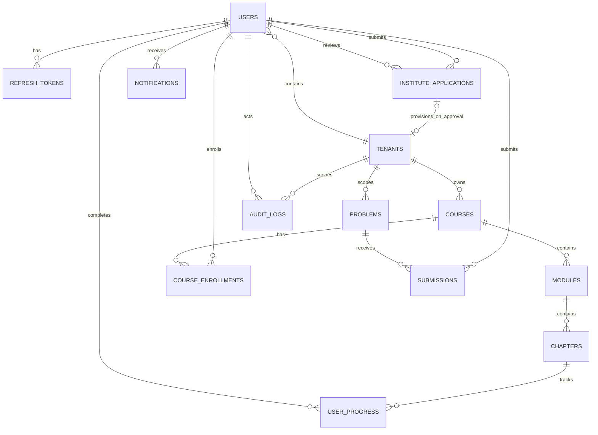

# CodeMitra platform architecture

This document turns the multi-role platform brief into a reviewable design and a staged delivery contract. CodeMitra already has a Next.js client, an Express/TypeScript API, PostgreSQL, and working learning modules. This plan extends that repository rather than replacing it. `institution` in the product brief maps to the existing `tenant` model; the existing `general_student` role is the general-user role.

## Stack and architecture

- Web: Next.js 14 App Router, React 18, TypeScript, Tailwind, React Query, Zustand.
- API: Express 4, TypeScript, Zod validation, JWT access tokens, rotating hashed refresh tokens, bcrypt, Helmet, CORS, rate limits.
- Persistence: PostgreSQL 14+, Drizzle for typed schema work and SQL migrations for controlled changes. Every institute-owned query must scope by the authenticated institute on the server; PostgreSQL RLS can provide defense in depth after request transaction context is standardized.
- Execution: existing Judge0 integration remains an isolated service boundary. Secrets are server-only environment variables. No client-supplied role or institute identifier can grant authority.
- Request path: browser → versioned `/api/v1` routes → authentication and role/tenant authorization → service transaction → PostgreSQL; sensitive state changes create audit events and user-facing notifications.

## Sitemap and navigation hierarchy

| Audience | Primary pages and submenus |
|---|---|
| Public / general user | `/`; `/courses` → course detail; `/problems`; `/blog`; `/contact`; `/login`; `/register`; `/forgot-password`; `/dashboard` → overview, problems, submissions; `/my-learning`; profile and notifications; apply to an institute |
| Institute student | `/dashboard` → learning overview, assigned work, progress; `/courses` → enrolled course, modules, lessons; `/problems`; `/assignments`; `/quizzes`; `/notifications`; profile; institute information |
| Institute admin | `/institution/dashboard`; `/institution/students` → applications, members, imports; `/institution/courses` → course editor, modules, lessons, enrollments; `/institution/assignments`; `/institution/analytics`; `/institution/notifications`; `/institution/settings` → profile, staff, academic configuration |
| Super admin | `/super-admin/dashboard`; `/super-admin/users`; `/super-admin/institutions` → directory, applications, detail; `/super-admin/general-users`; `/super-admin/courses`; `/super-admin/problems`; content and SEO; configuration; reports; notifications; support; audit and security; integrations and operations |

Only routes backed by an API and authorization policy should appear in navigation. Existing pages are inventoried in the repository; planned items above remain pending until their complete workflows ship.

## Role and permission matrix

Legend: **All** = platform-wide; **Assigned** = only the caller's active institute; **Own** = caller's own data; **Public** = published/public resources; **No** = denied.

| Capability | Super admin | Institute admin | Institute student | General user |
|---|---|---|---|---|
| Manage global users, roles, settings, audit | All | No | No | No |
| Approve institute applications / suspend institutes | All | No | No | Apply to own |
| Manage institute users, courses, reports | All | Assigned | No | No |
| Read private academic records | Audited, justified | Assigned, minimum necessary | Own | No |
| Read/enroll in public learning resources | All | Public + assigned | Public + assigned | Public + entitled |
| Submit work and view progress | Own | No | Own | Own public work |
| Change own profile and preferences | Own | Own | Own | Own |
| Grant or elevate roles | All, audited | No global roles | No | No |

Authorization is enforced in API middleware/services and tenant-scoped SQL. Hiding a control is not authorization. Admin role assignment never accepts `super_admin` from a public or institute-admin request.

## Entity relationship diagram

Existing schema tables cover users, tenants, refresh tokens, learning content, enrollments/progress, submissions, notifications, and audit logs. Migration 009 adds `institute_applications`, tied to the authenticated applicant and, after approval, the provisioned tenant. Future additions (explicit multi-institute memberships, branch/class structures, content revisions, support, configuration history, MFA) are not represented as shipped until migrations and workflows exist.

## Registration and membership workflows

### General account

1. `POST /auth/register` creates a `general_student` with an unverified email and no tenant. The client cannot choose a role or tenant.
2. Email verification (pending implementation) proves address ownership before privileged or sensitive actions.
3. The user can browse public content and manage their own profile, subject to account state.

### Institute onboarding and admin membership

1. An authenticated general user submits institute identity/contact details to `POST /tenants/applications`; the API derives applicant ID from JWT, normalizes/validates the slug, and records `pending`.
2. Only a super admin can list the review queue or decide an application. Decisions are one-way from pending and audited.
3. Approval runs in one database transaction: lock application, confirm pending state and available slug, create tenant, link application, and convert the applicant to `institution_admin` with that tenant ID. Any error rolls back all changes.
4. Rejection stores reviewer, timestamp, and an optional note without creating a tenant or changing the applicant's role.

### Student membership

1. A student applies or is invited to one institute (full admission workflow pending).
2. Admission must create/activate an explicit membership only after an authorized decision; a request alone does not confer student access.
3. Existing deployments encode a single institute in `users.tenant_id` and `users.role`. Moving to explicit memberships is a planned migration; until then, every institute operation must bind the user and resource to that single tenant.

## API specification

All endpoints are versioned under `/api/v1`, return `{ success, data, error?, meta? }`, validate input, and use bearer access tokens except public discovery/registration. Pagination uses `page` and `limit`.

| Method and path | Access | Workflow |
|---|---|---|
| `POST /auth/register`, `/auth/login`, `/auth/refresh`, `/auth/logout`, `GET /auth/me` | Public / own | Account and session lifecycle |
| `POST /tenants/applications` | Authenticated general user | Submit institute application |
| `GET /tenants/applications` | Super admin | Paginated review queue |
| `PATCH /tenants/applications/:id` | Super admin | Approve/reject with optional note; atomic approval |
| `GET /tenants/me` | Assigned institute admin/student | Read own institute profile |
| `/users`, `/courses`, `/problems`, `/submissions`, `/assignments`, `/quizzes` | Role/resource policy | Existing learning and administration APIs; each route must enforce ownership, entitlement, and tenant scope |
| `/notifications`, `/analytics`, `/blog`, `/newsletter` | Role/resource policy | Existing notifications, reports, and public content endpoints |

Planned endpoint families: membership/admissions, invitations, instructor assignment, content revisions, SEO/configuration, support, exports, audit search, security events, and deployment operations. They are not claimed as complete until implemented and covered by authorization tests.

## Roadmap and feature-to-test traceability

| Phase | Deliverable | Acceptance evidence |
|---|---|---|
| 1 Foundation | schema/migrations, auth, roles, tenant scope, shared layout | migration applies; registration cannot set role/tenant; tenant-crossing requests denied |
| 2 Governance | super-admin users/institutions, approval queue, audit | only super admin can decide; approval transaction is atomic/idempotent; reviewer/action recorded |
| 3 Institute operations | student admission, staff, academic structures | pending users have no access; active member sees only assigned institute; institute admin cannot elevate roles |
| 4 Learning | courses, problems, assessments, submissions, progress | enrollment gates private course; owner-only submissions/progress; grading audit |
| 5 General experience | public discovery, self-service, institute applications | public-only access before membership; application does not self-provision institute privileges |
| 6 Supporting systems | content, SEO, notifications, reports, support | publication schedule and visibility enforced; reports use identical tenant scope; events trace to actor/request |
| 7 Production readiness | security, monitoring, backup/restore, operations guide | security regression matrix; migration/restore rehearsal; documented deployment and rollback |

| Feature | Current state in repository | Verification target |
|---|---|---|
| General registration and password login | Implemented; verification/reset workflows remain pending | API tests for fixed role, password hashing, lockout, session rotation |
| Tenant and role primitives | Implemented with single `tenant_id` | Cross-tenant API tests for every private resource |
| Institute applications | Migration 009 and API/UI workflow implemented; automated DB integration coverage pending | apply/list/approve/reject tests, duplicate and transaction rollback cases |
| Course catalog and enrollment | Existing API/UI | published visibility, entitlement and progress ownership tests |
| Problem practice/submissions | Existing API/UI; workspace has pending user edits | preserve and verify learner/admin action boundaries |
| Audit/notifications | Basic tables and audit helper exist | assert critical actions include actor, target, tenant, outcome and request ID |
| Global CMS, SEO, support, full operations | Pending | endpoint, persistence, RBAC, responsive workflow, and failure-state tests |

## Delivery status and exclusions

Implemented before this plan: coding education workflows, JWT sessions, role middleware, tenant-scoped user/course services, analytics, notifications, basic audits, public learning pages, and super-admin/institute screens. Migration 009, the application API, applicant form, and super-admin review queue implement the institute onboarding slice. A truly production-ready full LMS remains a staged delivery: billing, comprehensive email delivery/verification, MFA, explicit multi-institute memberships, academic administration, broad CMS/SEO, support, backup orchestration, and end-to-end coverage are not silently represented as done.
